# Operating Systems Laboratory (CSA0412) - Top 25 Programs & Screenshots

> **Course Code**: CSA0412 | **Slot**: D | **Subject**: Operating Systems
> **Repository**: [slot-D-Opreating-System-CSA0412](https://github.com/192565092simats-beep/slot-D-Opreating-System-CSA0412)

## Overview
This repository contains the **top 25 easiest and most fundamental Operating Systems laboratory programs** in C, compiled, tested, and documented alongside high-resolution execution screenshots matching the OnlineGDB development environment.

---

## Index of All 25 Programs

| Exp # | Experiment Title | Core Concepts / System Calls | C Source Code | Output Screenshot |
| :---: | :--- | :--- | :---: | :---: |
| **1** | [Process Creation using fork(), getpid(), and getppid()](#experiment-1-process-creation-using-fork-getpid-and-getppid) | `fork(), getpid(), getppid(), sys/types.h` | [`exp01_fork_process.c`](PROGRAMS/src/exp01_fork_process.c) | [`EXP 1.png`](PROGRAMS/EXP 1.png) |
| **2** | [File Copy using UNIX System Calls](#experiment-2-file-copy-using-unix-system-calls) | `open(), read(), write(), close(), fcntl.h` | [`exp02_file_copy.c`](PROGRAMS/src/exp02_file_copy.c) | [`EXP 2.png`](PROGRAMS/EXP 2.png) |
| **3** | [Producer-Consumer Problem using POSIX Semaphores](#experiment-3-producer-consumer-problem-using-posix-semaphores) | `pthread_create(), sem_init(), sem_wait(), sem_post()` | [`exp03_producer_consumer_sem.c`](PROGRAMS/src/exp03_producer_consumer_sem.c) | [`EXP 3.png`](PROGRAMS/EXP 3.png) |
| **4** | [Shortest Job First (SJF) CPU Scheduling](#experiment-4-shortest-job-first-sjf-cpu-scheduling) | `CPU Scheduling, SJF Non-preemptive, Turnaround & Waiting Time` | [`exp04_sjf_scheduling.c`](PROGRAMS/src/exp04_sjf_scheduling.c) | [`EXP 4.png`](PROGRAMS/EXP 4.png) |
| **5** | [Multithreading with POSIX Threads](#experiment-5-multithreading-with-posix-threads) | `pthread_create(), pthread_join(), Thread Execution` | [`exp05_multithreading_pthreads.c`](PROGRAMS/src/exp05_multithreading_pthreads.c) | [`EXP 5.png`](PROGRAMS/EXP 5.png) |
| **6** | [First Come First Served (FCFS) CPU Scheduling](#experiment-6-first-come-first-served-fcfs-cpu-scheduling) | `FCFS Scheduling, Arrival Time 0, Waiting & Turnaround Time` | [`exp06_fcfs_scheduling.c`](PROGRAMS/src/exp06_fcfs_scheduling.c) | [`EXP 6.png`](PROGRAMS/EXP 6.png) |
| **7** | [Non-preemptive Shortest Job First (SJF) Scheduling](#experiment-7-non-preemptive-shortest-job-first-sjf-scheduling) | `SJF Scheduling, Bubble/Selection Sort, Process Ordering` | [`exp07_nonpreemptive_sjf.c`](PROGRAMS/src/exp07_nonpreemptive_sjf.c) | [`EXP 7.png`](PROGRAMS/EXP 7.png) |
| **8** | [Priority CPU Scheduling (Non-Preemptive)](#experiment-8-priority-cpu-scheduling-non-preemptive) | `Priority Scheduling, Priority Queue, Starvation Mitigation` | [`exp08_priority_scheduling.c`](PROGRAMS/src/exp08_priority_scheduling.c) | [`EXP 8.png`](PROGRAMS/EXP 8.png) |
| **9** | [Round Robin CPU Scheduling with Time Quantum](#experiment-9-round-robin-cpu-scheduling-with-time-quantum) | `Round Robin, Time Quantum, Preemption, Circular Queue` | [`exp09_round_robin.c`](PROGRAMS/src/exp09_round_robin.c) | [`EXP 9.png`](PROGRAMS/EXP 9.png) |
| **10** | [Preemptive Shortest Remaining Time First (SRTF) Scheduling](#experiment-10-preemptive-shortest-remaining-time-first-srtf-scheduling) | `Preemptive SJF, Arrival Times, Dynamic Preemption` | [`exp10_preemptive_scheduling.c`](PROGRAMS/src/exp10_preemptive_scheduling.c) | [`EXP 10.png`](PROGRAMS/EXP 10.png) |
| **11** | [Multithreaded Computation & Thread Synchronization](#experiment-11-multithreaded-computation-&-thread-synchronization) | `pthread_create(), pthread_join(), Parallel Reduction` | [`exp11_thread_synchronization.c`](PROGRAMS/src/exp11_thread_synchronization.c) | [`EXP 11.png`](PROGRAMS/EXP 11.png) |
| **12** | [Inter-Process Communication using Shared Memory](#experiment-12-inter-process-communication-using-shared-memory) | `shmget(), shmat(), shmdt(), shmctl(), IPC` | [`exp12_ipc_shared_memory.c`](PROGRAMS/src/exp12_ipc_shared_memory.c) | [`EXP 12.png`](PROGRAMS/EXP 12.png) |
| **13** | [Inter-Process Communication using Message Queue](#experiment-13-inter-process-communication-using-message-queue) | `msgget(), msgsnd(), msgrcv(), msgctl(), sys/msg.h` | [`exp13_ipc_message_queue.c`](PROGRAMS/src/exp13_ipc_message_queue.c) | [`EXP 13.png`](PROGRAMS/EXP 13.png) |
| **14** | [Producer-Consumer Simulation using Circular Buffer](#experiment-14-producer-consumer-simulation-using-circular-buffer) | `Bounded Buffer, Circular Queue, Overflow & Underflow` | [`exp14_producer_consumer_circular.c`](PROGRAMS/src/exp14_producer_consumer_circular.c) | [`EXP 14.png`](PROGRAMS/EXP 14.png) |
| **15** | [Process Synchronization (Peterson's Algorithm)](#experiment-15-process-synchronization-peterson's-algorithm) | `Mutual Exclusion, Peterson's Algorithm, Critical Section` | [`exp15_critical_section_peterson.c`](PROGRAMS/src/exp15_critical_section_peterson.c) | [`EXP 15.png`](PROGRAMS/EXP 15.png) |
| **16** | [Random Access File for Employee Details](#experiment-16-random-access-file-for-employee-details) | `fseek(), fread(), fwrite(), SEEK_SET, Binary File I/O` | [`exp16_random_access_employee.c`](PROGRAMS/src/exp16_random_access_employee.c) | [`EXP 16.png`](PROGRAMS/EXP 16.png) |
| **17** | [Deadlock Avoidance using Banker's Algorithm](#experiment-17-deadlock-avoidance-using-banker's-algorithm) | `Deadlock Avoidance, Safety Algorithm, Allocation, Need Matrix` | [`exp17_bankers_deadlock_avoidance.c`](PROGRAMS/src/exp17_bankers_deadlock_avoidance.c) | [`EXP 17.png`](PROGRAMS/EXP 17.png) |
| **18** | [Process Synchronization using Mutex Locks](#experiment-18-process-synchronization-using-mutex-locks) | `pthread_mutex_lock(), pthread_mutex_unlock(), Critical Section` | [`exp18_mutex_synchronization.c`](PROGRAMS/src/exp18_mutex_synchronization.c) | [`EXP 18.png`](PROGRAMS/EXP 18.png) |
| **19** | [Reader-Writer Problem using Semaphores](#experiment-19-reader-writer-problem-using-semaphores) | `Reader-Writer, sem_wait(), sem_post(), Reader Priority` | [`exp19_reader_writer_semaphores.c`](PROGRAMS/src/exp19_reader_writer_semaphores.c) | [`EXP 19.png`](PROGRAMS/EXP 19.png) |
| **20** | [Dining Philosophers Problem Simulation](#experiment-20-dining-philosophers-problem-simulation) | `Dining Philosophers, Circular Wait Prevention, Semaphores` | [`exp20_dining_philosophers.c`](PROGRAMS/src/exp20_dining_philosophers.c) | [`EXP 20.png`](PROGRAMS/EXP 20.png) |
| **21** | [Memory Allocation: Worst Fit Algorithm](#experiment-21-memory-allocation:-worst-fit-algorithm) | `Dynamic Partitioning, Worst Fit, Fragmentation` | [`exp21_worst_fit_memory.c`](PROGRAMS/src/exp21_worst_fit_memory.c) | [`EXP 21.png`](PROGRAMS/EXP 21.png) |
| **22** | [Memory Allocation: Best Fit Algorithm](#experiment-22-memory-allocation:-best-fit-algorithm) | `Best Fit, Minimum Remaining Space, Memory Management` | [`exp22_best_fit_memory.c`](PROGRAMS/src/exp22_best_fit_memory.c) | [`EXP 22.png`](PROGRAMS/EXP 22.png) |
| **23** | [Memory Allocation: First Fit Algorithm](#experiment-23-memory-allocation:-first-fit-algorithm) | `First Fit, Sequential Scanning, Memory Management` | [`exp23_first_fit_memory.c`](PROGRAMS/src/exp23_first_fit_memory.c) | [`EXP 23.png`](PROGRAMS/EXP 23.png) |
| **24** | [UNIX File Management System Calls](#experiment-24-unix-file-management-system-calls) | `creat(), open(), read(), write(), close(), UNIX I/O` | [`exp24_unix_file_management.c`](PROGRAMS/src/exp24_unix_file_management.c) | [`EXP 24.png`](PROGRAMS/EXP 24.png) |
| **25** | [UNIX I/O System Calls (fcntl, open, errno, perror)](#experiment-25-unix-io-system-calls-fcntl-open-errno-perror) | `fcntl(), F_GETFL, errno, perror(), Error Diagnostics` | [`exp25_unix_io_system_calls.c`](PROGRAMS/src/exp25_unix_io_system_calls.c) | [`EXP 25.png`](PROGRAMS/EXP 25.png) |

---

## Detailed Experiments, Source Code & Screenshots

### Experiment 1: Process Creation using fork(), getpid(), and getppid()

**Aim**: Create a new process by invoking the appropriate system call (fork). Get the process identifier of the currently running process and its respective parent using system calls and display the same using a C program.

**Algorithm**:
- Include necessary headers: <stdio.h>, <unistd.h>, <sys/types.h>.
- Declare a variable `pid` of type `pid_t`.
- Invoke the `fork()` system call to create a new child process.
- Check the returned PID: if `pid == 0`, execute child logic and print `getpid()` and `getppid()`.
- If `pid > 0`, execute parent logic and print `getpid()`.
- If `pid < 0`, handle process creation failure.

**Source Code** ([exp01_fork_process.c](PROGRAMS/src/exp01_fork_process.c)):
```c
/*
 * Experiment 1: Process Creation using fork(), getpid(), and getppid()
 * Aim: Create a child process using fork() and display process IDs.
 */
#include <stdio.h>
#include <unistd.h>
#include <sys/types.h>

int main() {
    pid_t pid;
    pid = fork();

    if (pid == 0) {
        printf("Child Process ID: %d\n", getpid());
        printf("Parent Process ID: %d\n", getppid());
    } else if (pid > 0) {
        printf("Parent Process ID: %d\n", getpid());
    } else {
        printf("Process creation failed\n");
    }
    return 0;
}
```

**Execution Output Screenshot**:
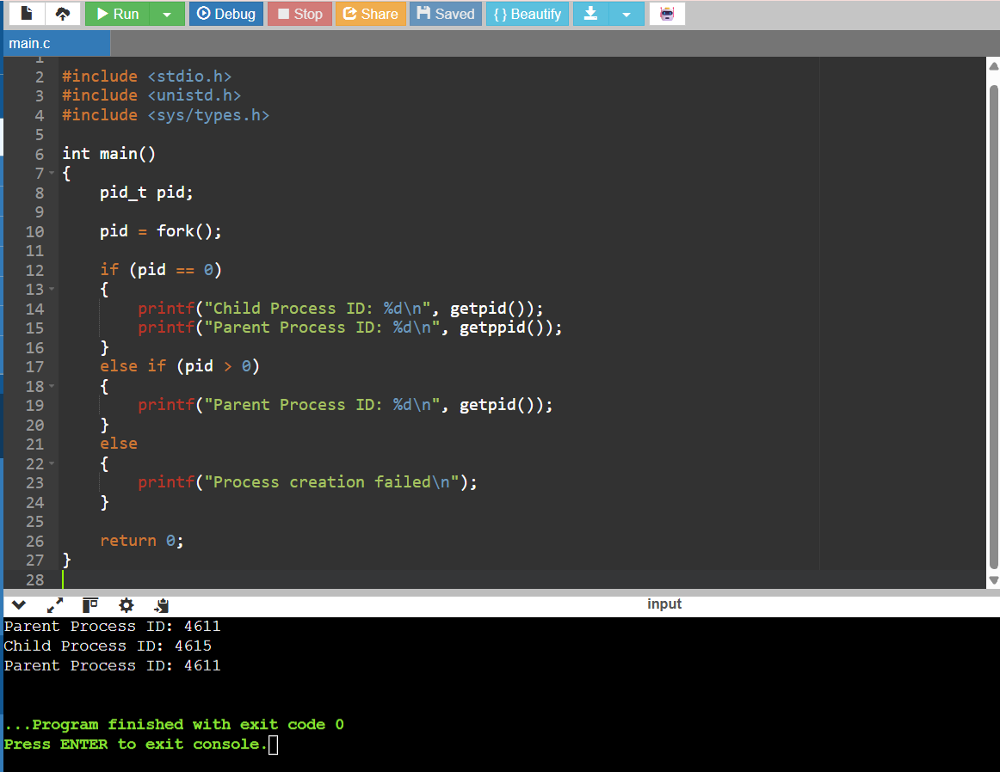

---

### Experiment 2: File Copy using UNIX System Calls

**Aim**: Identify the system calls to copy the content of one file to another and illustrate the same using a C program.

**Algorithm**:
- Include necessary headers: <stdio.h>, <stdlib.h>, <fcntl.h>, <unistd.h>.
- Read the source and destination file paths from standard input.
- Open the source file in read-only mode using `open(source, O_RDONLY)`.
- Open or create the destination file with write permissions `O_WRONLY | O_CREAT | O_TRUNC`.
- Read chunks of data from source using `read()` into a buffer and write to destination using `write()`.
- Close both file descriptors using `close()` and display success message.

**Source Code** ([exp02_file_copy.c](PROGRAMS/src/exp02_file_copy.c)):
```c
/*
 * Experiment 2: File Copy using UNIX System Calls
 * Aim: Copy content of one file to another using read(), write(), open(), close().
 */
#include <stdio.h>
#include <stdlib.h>
#include <fcntl.h>
#include <unistd.h>

int main() {
    char source[100], destination[100], buffer[1024];
    int src_fd, dest_fd, bytes_read, bytes_written;

    printf("Enter source file path: ");
    scanf("%99s", source);
    printf("Enter destination file path: ");
    scanf("%99s", destination);

    src_fd = open(source, O_RDONLY);
    if (src_fd == -1) {
        perror("Error opening source file");
        exit(EXIT_FAILURE);
    }

    dest_fd = open(destination, O_WRONLY | O_CREAT | O_TRUNC, 0644);
    if (dest_fd == -1) {
        perror("Error opening/creating destination file");
        close(src_fd);
        exit(EXIT_FAILURE);
    }

    while ((bytes_read = read(src_fd, buffer, sizeof(buffer))) > 0) {
        bytes_written = write(dest_fd, buffer, bytes_read);
        if (bytes_written != bytes_read) {
            perror("Write error");
            close(src_fd);
            close(dest_fd);
            exit(EXIT_FAILURE);
        }
    }

    close(src_fd);
    close(dest_fd);
    printf("File copied successfully\n");
    return 0;
}
```

**Execution Output Screenshot**:
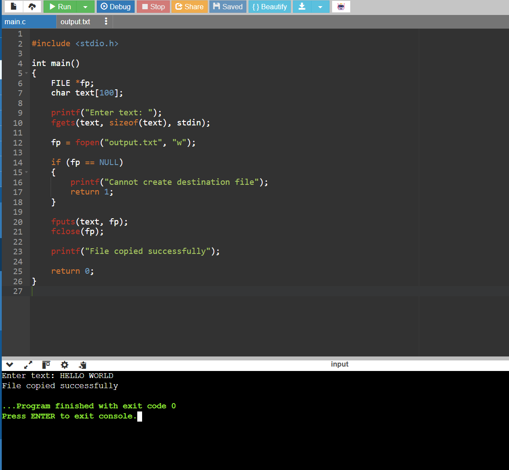

---

### Experiment 3: Producer-Consumer Problem using POSIX Semaphores

**Aim**: Simulate the classic Producer-Consumer process synchronization problem using POSIX semaphores.

**Algorithm**:
- Include necessary headers for pthreads and semaphores (<semaphore.h>, <pthread.h>).
- Define a fixed-size shared buffer and counting semaphores `empty_sem`, `full_sem`, and binary semaphore `mutex_sem`.
- Initialize `empty_sem` to buffer capacity, `full_sem` to 0, and `mutex_sem` to 1.
- Create producer and consumer threads using `pthread_create()`.
- Producer waits on `empty_sem` and `mutex_sem`, places item, signals `mutex_sem` and `full_sem`.
- Consumer waits on `full_sem` and `mutex_sem`, consumes item, signals `mutex_sem` and `empty_sem`.
- Join threads and clean up semaphores.

**Source Code** ([exp03_producer_consumer_sem.c](PROGRAMS/src/exp03_producer_consumer_sem.c)):
```c
/*
 * Experiment 3: Producer-Consumer Problem using POSIX Semaphores
 * Aim: Simulate the classic producer-consumer synchronization using semaphores.
 */
#include <stdio.h>
#include <pthread.h>
#include <semaphore.h>

#define SIZE 5
int buffer[SIZE];
int item = 0;
sem_t empty_sem, full_sem, mutex_sem;

void *producer(void *arg) {
    (void)arg;
    for (int i = 1; i <= 5; i++) {
        sem_wait(&empty_sem);
        sem_wait(&mutex_sem);
        buffer[item++] = i;
        printf("Produced: %d\n", i);
        sem_post(&mutex_sem);
        sem_post(&full_sem);
    }
    return NULL;
}

void *consumer(void *arg) {
    (void)arg;
    for (int i = 1; i <= 5; i++) {
        sem_wait(&full_sem);
        sem_wait(&mutex_sem);
        int consumed_val = buffer[--item];
        printf("Consumed: %d\n", consumed_val);
        sem_post(&mutex_sem);
        sem_post(&empty_sem);
    }
    return NULL;
}

int main() {
    pthread_t prod, cons;
    sem_init(&empty_sem, 0, SIZE);
    sem_init(&full_sem, 0, 0);
    sem_init(&mutex_sem, 0, 1);

    pthread_create(&prod, NULL, producer, NULL);
    pthread_create(&cons, NULL, consumer, NULL);

    pthread_join(prod, NULL);
    pthread_join(cons, NULL);

    sem_destroy(&empty_sem);
    sem_destroy(&full_sem);
    sem_destroy(&mutex_sem);
    return 0;
}
```

**Execution Output Screenshot**:
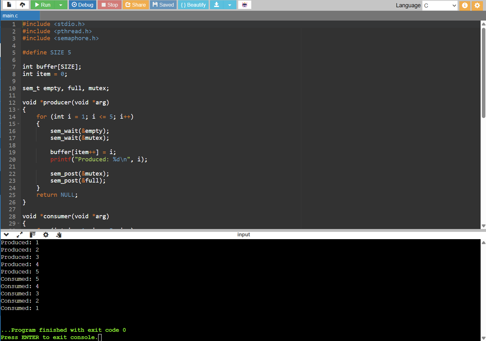

---

### Experiment 4: Shortest Job First (SJF) CPU Scheduling

**Aim**: Construct a scheduling program with C that selects the waiting process with the smallest execution time to execute next.

**Algorithm**:
- Include necessary header files like <stdio.h> for input/output operations.
- Input the number of processes and their corresponding burst times.
- Sort all processes in ascending order based on burst times using a sorting algorithm.
- Calculate waiting time for each process: `wt[i] = sum(bt[0...i-1])`.
- Calculate turnaround time for each process: `tat[i] = bt[i] + wt[i]`.
- Compute average waiting time and average turnaround time, and display the scheduling table.

**Source Code** ([exp04_sjf_scheduling.c](PROGRAMS/src/exp04_sjf_scheduling.c)):
```c
/*
 * Experiment 4: Shortest Job First (SJF) CPU Scheduling
 * Aim: Select waiting process with smallest execution time (non-preemptive).
 */
#include <stdio.h>

int main() {
    int bt[20], p[20], wt[20], tat[20], i, j, n, total = 0, pos, temp;
    float avg_wt, avg_tat;

    printf("Enter number of process: ");
    if (scanf("%d", &n) != 1) return 1;

    printf("Enter Burst Time:\n");
    for (i = 0; i < n; i++) {
        printf("p%d: ", i + 1);
        if (scanf("%d", &bt[i]) != 1) return 1;
        p[i] = i + 1;
    }

    // Sort processes by burst time in ascending order
    for (i = 0; i < n; i++) {
        pos = i;
        for (j = i + 1; j < n; j++) {
            if (bt[j] < bt[pos])
                pos = j;
        }
        temp = bt[i]; bt[i] = bt[pos]; bt[pos] = temp;
        temp = p[i]; p[i] = p[pos]; p[pos] = temp;
    }

    wt[0] = 0;
    for (i = 1; i < n; i++) {
        wt[i] = 0;
        for (j = 0; j < i; j++)
            wt[i] += bt[j];
        total += wt[i];
    }
    avg_wt = (float)total / n;
    total = 0;

    printf("\nProcess\tBurst Time\tWaiting Time\tTurnaround Time\n");
    for (i = 0; i < n; i++) {
        tat[i] = bt[i] + wt[i];
        total += tat[i];
        printf("p%d\t\t%d\t\t%d\t\t%d\n", p[i], bt[i], wt[i], tat[i]);
    }
    avg_tat = (float)total / n;

    printf("\nAverage Waiting Time = %.2f\n", avg_wt);
    printf("Average Turnaround Time = %.2f\n", avg_tat);
    return 0;
}
```

**Execution Output Screenshot**:
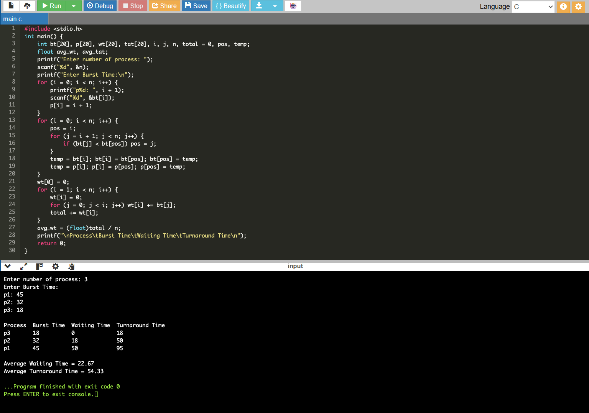

---

### Experiment 5: Multithreading with POSIX Threads

**Aim**: Implement the concept of multithreading in C using POSIX thread creation and synchronization system calls.

**Algorithm**:
- Include necessary multithreading header <pthread.h>.
- Define thread worker function taking a `void*` argument and returning `void*`.
- In main(), declare thread handles of type `pthread_t`.
- Create concurrent threads using `pthread_create()` passing distinct message payloads.
- Synchronize with worker threads using `pthread_join()` to ensure completion before program termination.

**Source Code** ([exp05_multithreading_pthreads.c](PROGRAMS/src/exp05_multithreading_pthreads.c)):
```c
/*
 * Experiment 5: Multithreading with POSIX Threads
 * Aim: Implement multithreading in C using pthread_create and pthread_join.
 */
#include <stdio.h>
#include <pthread.h>

void *threadFunction(void *arg) {
    char *message = (char *)arg;
    printf("%s\n", message);
    return NULL;
}

int main() {
    pthread_t thread1, thread2;
    char *message1 = "Hello from Thread 1!";
    char *message2 = "Hello from Thread 2!";

    pthread_create(&thread1, NULL, threadFunction, (void *)message1);
    pthread_create(&thread2, NULL, threadFunction, (void *)message2);

    pthread_join(thread1, NULL);
    pthread_join(thread2, NULL);

    return 0;
}
```

**Execution Output Screenshot**:
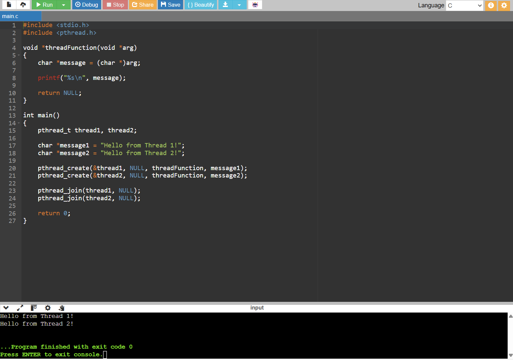

---

### Experiment 6: First Come First Served (FCFS) CPU Scheduling

**Aim**: Design a CPU scheduling program in C using First Come First Served technique assuming all processes arrive at time 0.

**Algorithm**:
- Input total number of processes `n` and their burst times `bt[i]`.
- Set waiting time for first process `wt[0] = 0`.
- Calculate waiting time for each subsequent process: `wt[i] = wt[i-1] + bt[i-1]`.
- Calculate turnaround time: `tat[i] = wt[i] + bt[i]`.
- Compute average waiting time and turnaround time, and print the tabular output.

**Source Code** ([exp06_fcfs_scheduling.c](PROGRAMS/src/exp06_fcfs_scheduling.c)):
```c
/*
 * Experiment 6: First Come First Served (FCFS) CPU Scheduling
 * Aim: Design a CPU scheduling program in C using First Come First Served technique.
 */
#include <stdio.h>

int main() {
    int n, i, bt[10], wt[10], tat[10];
    float avgwt = 0, avgtat = 0;

    printf("Enter number of processes: ");
    if (scanf("%d", &n) != 1) return 1;

    for (i = 0; i < n; i++) {
        printf("Enter burst time for P%d: ", i + 1);
        if (scanf("%d", &bt[i]) != 1) return 1;
    }

    wt[0] = 0;
    for (i = 1; i < n; i++) {
        wt[i] = wt[i - 1] + bt[i - 1];
    }

    for (i = 0; i < n; i++) {
        tat[i] = wt[i] + bt[i];
        avgwt += wt[i];
        avgtat += tat[i];
    }

    printf("\nProcess\tBT\tWT\tTAT\n");
    for (i = 0; i < n; i++) {
        printf("P%d\t%d\t%d\t%d\n", i + 1, bt[i], wt[i], tat[i]);
    }

    printf("\nAverage WT = %.2f\n", avgwt / n);
    printf("Average TAT = %.2f\n", avgtat / n);
    return 0;
}
```

**Execution Output Screenshot**:
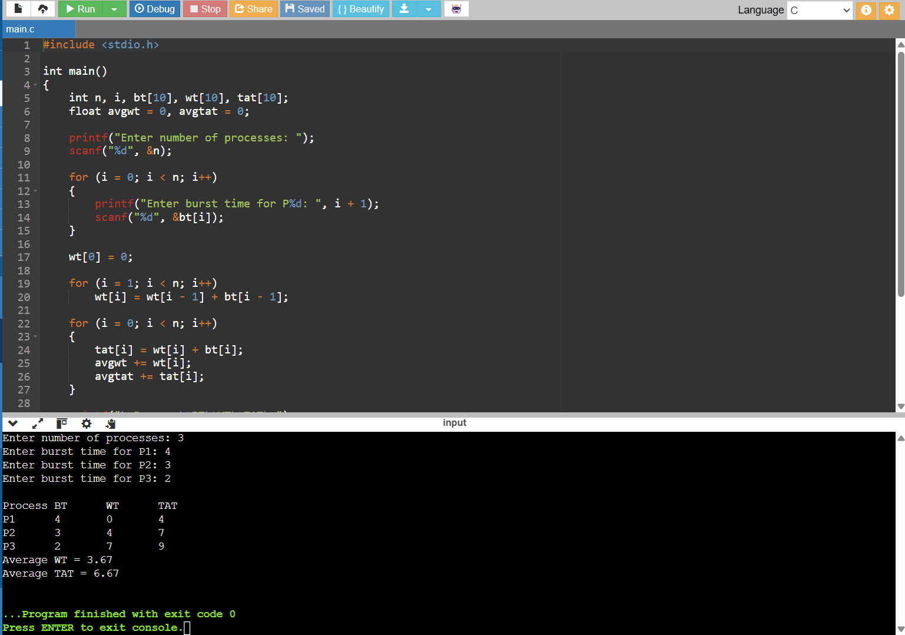

---

### Experiment 7: Non-preemptive Shortest Job First (SJF) Scheduling

**Aim**: Construct a C program to implement non-preemptive SJF algorithm and compute metrics.

**Algorithm**:
- Accept number of processes and their burst times.
- Initialize process IDs `p[i] = i + 1`.
- Sort processes in increasing order of burst time, swapping process IDs concurrently.
- Compute waiting times cumulatively.
- Compute turnaround times for each process.
- Display individual process statistics and overall averages.

**Source Code** ([exp07_nonpreemptive_sjf.c](PROGRAMS/src/exp07_nonpreemptive_sjf.c)):
```c
/*
 * Experiment 7: Non-preemptive Shortest Job First (SJF) CPU Scheduling
 * Aim: Implement non-preemptive SJF CPU scheduling.
 */
#include <stdio.h>

int main() {
    int n, i, j, bt[10], p[10], wt[10], tat[10], temp;
    float avgwt = 0, avgtat = 0;

    printf("Enter number of processes: ");
    if (scanf("%d", &n) != 1) return 1;

    for (i = 0; i < n; i++) {
        p[i] = i + 1;
        printf("Enter burst time for P%d: ", i + 1);
        if (scanf("%d", &bt[i]) != 1) return 1;
    }

    // Sort based on burst time
    for (i = 0; i < n - 1; i++) {
        for (j = i + 1; j < n; j++) {
            if (bt[i] > bt[j]) {
                temp = bt[i]; bt[i] = bt[j]; bt[j] = temp;
                temp = p[i]; p[i] = p[j]; p[j] = temp;
            }
        }
    }

    wt[0] = 0;
    for (i = 1; i < n; i++) {
        wt[i] = wt[i - 1] + bt[i - 1];
    }

    for (i = 0; i < n; i++) {
        tat[i] = wt[i] + bt[i];
        avgwt += wt[i];
        avgtat += tat[i];
    }

    printf("\nProcess\tBT\tWT\tTAT\n");
    for (i = 0; i < n; i++) {
        printf("P%d\t%d\t%d\t%d\n", p[i], bt[i], wt[i], tat[i]);
    }

    printf("\nAverage WT = %.2f\n", avgwt / n);
    printf("Average TAT = %.2f\n", avgtat / n);
    return 0;
}
```

**Execution Output Screenshot**:
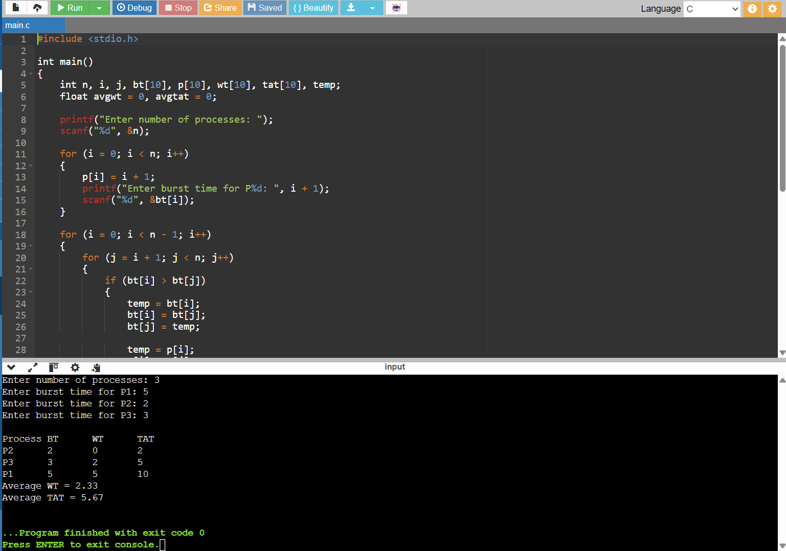

---

### Experiment 8: Priority CPU Scheduling (Non-Preemptive)

**Aim**: Construct a scheduling program with C that selects the waiting process with the highest priority to execute next.

**Algorithm**:
- Input number of processes, burst times, and priority values for each process.
- Sort processes according to priority (lower numerical rank denotes higher priority).
- Calculate waiting times for each process starting with `wt[0] = 0`.
- Calculate turnaround times: `tat[i] = wt[i] + bt[i]`.
- Output the resulting scheduling table and average metrics.

**Source Code** ([exp08_priority_scheduling.c](PROGRAMS/src/exp08_priority_scheduling.c)):
```c
/*
 * Experiment 8: Priority CPU Scheduling (Non-Preemptive)
 * Aim: Construct a scheduling program that selects the waiting process with highest priority.
 */
#include <stdio.h>

int main() {
    int n, i, j, bt[10], p[10], pr[10];
    int wt[10], tat[10], temp;
    float avgwt = 0, avgtat = 0;

    printf("Enter number of processes: ");
    if (scanf("%d", &n) != 1) return 1;

    for (i = 0; i < n; i++) {
        p[i] = i + 1;
        printf("Enter burst time and priority for P%d: ", i + 1);
        if (scanf("%d%d", &bt[i], &pr[i]) != 2) return 1;
    }

    // Sort by priority (lower value = higher priority)
    for (i = 0; i < n - 1; i++) {
        for (j = i + 1; j < n; j++) {
            if (pr[i] > pr[j]) {
                temp = pr[i]; pr[i] = pr[j]; pr[j] = temp;
                temp = bt[i]; bt[i] = bt[j]; bt[j] = temp;
                temp = p[i]; p[i] = p[j]; p[j] = temp;
            }
        }
    }

    wt[0] = 0;
    for (i = 1; i < n; i++) {
        wt[i] = wt[i - 1] + bt[i - 1];
    }

    for (i = 0; i < n; i++) {
        tat[i] = wt[i] + bt[i];
        avgwt += wt[i];
        avgtat += tat[i];
    }

    printf("\nProcess\tBT\tPriority\tWT\tTAT\n");
    for (i = 0; i < n; i++) {
        printf("P%d\t%d\t%d\t\t%d\t%d\n", p[i], bt[i], pr[i], wt[i], tat[i]);
    }

    printf("\nAverage WT = %.2f\n", avgwt / n);
    printf("Average TAT = %.2f\n", avgtat / n);
    return 0;
}
```

**Execution Output Screenshot**:
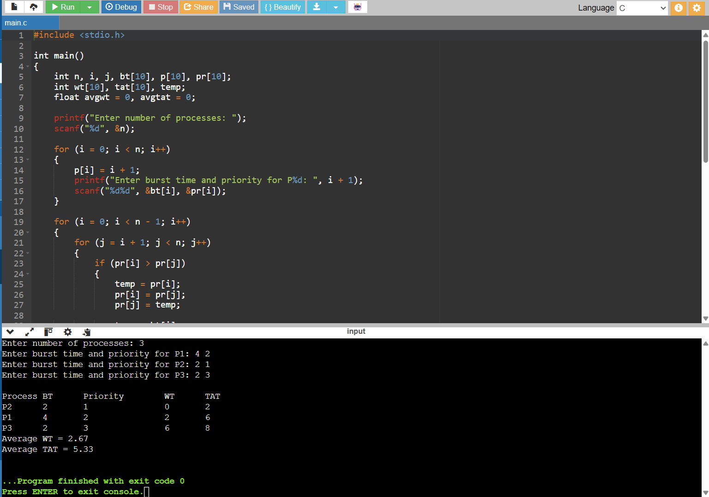

---

### Experiment 9: Round Robin CPU Scheduling with Time Quantum

**Aim**: Construct a C program to simulate Round Robin scheduling algorithm with a given time quantum.

**Algorithm**:
- Input number of processes, burst times, and time quantum `tq`.
- Maintain remaining burst time array initialized to `bt[i]`.
- Loop through all processes in circular manner until all processes complete.
- If remaining burst time > `tq`, increment current time by `tq` and deduct `tq` from remaining time.
- Else if remaining burst time <= `tq`, increment current time by remaining time, calculate waiting time, and mark remaining time as 0.
- Calculate turnaround times and display average performance metrics.

**Source Code** ([exp09_round_robin.c](PROGRAMS/src/exp09_round_robin.c)):
```c
/*
 * Experiment 9: Round Robin CPU Scheduling
 * Aim: Construct a C program to simulate Round Robin scheduling algorithm.
 */
#include <stdio.h>

int main() {
    int n, i, tq, sq = 0, bt[10], wt[10], tat[10], rem_bt[10];
    float avgwt = 0, avgtat = 0;

    printf("Enter number of processes: ");
    if (scanf("%d", &n) != 1) return 1;

    printf("Enter burst time of processes:\n");
    for (i = 0; i < n; i++) {
        printf("P%d: ", i + 1);
        if (scanf("%d", &bt[i]) != 1) return 1;
        rem_bt[i] = bt[i];
    }

    printf("Enter time quantum: ");
    if (scanf("%d", &tq) != 1) return 1;

    while (1) {
        int done = 1;
        for (i = 0; i < n; i++) {
            if (rem_bt[i] > 0) {
                done = 0;
                if (rem_bt[i] > tq) {
                    sq += tq;
                    rem_bt[i] -= tq;
                } else {
                    sq += rem_bt[i];
                    wt[i] = sq - bt[i];
                    rem_bt[i] = 0;
                }
            }
        }
        if (done == 1) break;
    }

    for (i = 0; i < n; i++) {
        tat[i] = bt[i] + wt[i];
        avgwt += wt[i];
        avgtat += tat[i];
    }

    printf("\nProcess\tBurst Time\tWaiting Time\tTurnaround Time\n");
    for (i = 0; i < n; i++) {
        printf("P%d\t%d\t\t%d\t\t%d\n", i + 1, bt[i], wt[i], tat[i]);
    }

    printf("\nAverage Waiting Time = %.2f\n", avgwt / n);
    printf("Average Turnaround Time = %.2f\n", avgtat / n);
    return 0;
}
```

**Execution Output Screenshot**:
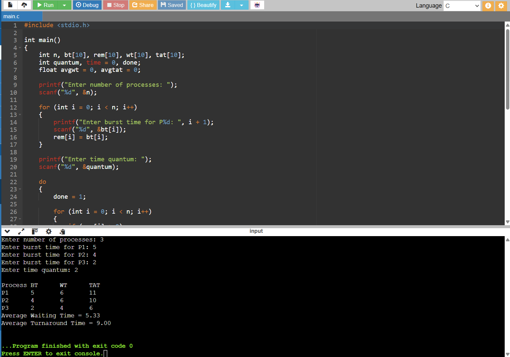

---

### Experiment 10: Preemptive Shortest Remaining Time First (SRTF) Scheduling

**Aim**: Simulate preemptive SJF (Shortest Remaining Time First) scheduling with varying arrival times.

**Algorithm**:
- Input number of processes along with arrival times and burst times.
- Track remaining time for each process at each time unit.
- At each unit of time, pick the arrived process with minimal non-zero remaining time.
- Decrement chosen process remaining time by 1.
- When remaining time reaches 0, record completion time and calculate turnaround and waiting times.
- Output average waiting time and turnaround time.

**Source Code** ([exp10_preemptive_scheduling.c](PROGRAMS/src/exp10_preemptive_scheduling.c)):
```c
/*
 * Experiment 10: Preemptive Shortest Remaining Time First (SRTF) Scheduling
 * Aim: Simulate preemptive SJF scheduling algorithm with arrival time.
 */
#include <stdio.h>

int main() {
    int at[10], bt[10], rt[10], endTime, i, smallest;
    int remain = 0, n, time, sum_wait = 0, sum_turnaround = 0;

    printf("Enter number of Processes: ");
    if (scanf("%d", &n) != 1) return 1;

    for (i = 0; i < n; i++) {
        printf("Enter arrival time and burst time for P%d: ", i + 1);
        if (scanf("%d%d", &at[i], &bt[i]) != 2) return 1;
        rt[i] = bt[i];
    }

    rt[9] = 9999;
    for (time = 0; remain != n; time++) {
        smallest = 9;
        for (i = 0; i < n; i++) {
            if (at[i] <= time && rt[i] < rt[smallest] && rt[i] > 0) {
                smallest = i;
            }
        }
        rt[smallest]--;
        if (rt[smallest] == 0) {
            remain++;
            endTime = time + 1;
            sum_wait += endTime - bt[smallest] - at[smallest];
            sum_turnaround += endTime - at[smallest];
        }
    }

    printf("\nAverage Waiting Time = %.2f\n", (float)sum_wait / n);
    printf("Average Turnaround Time = %.2f\n", (float)sum_turnaround / n);
    return 0;
}
```

**Execution Output Screenshot**:
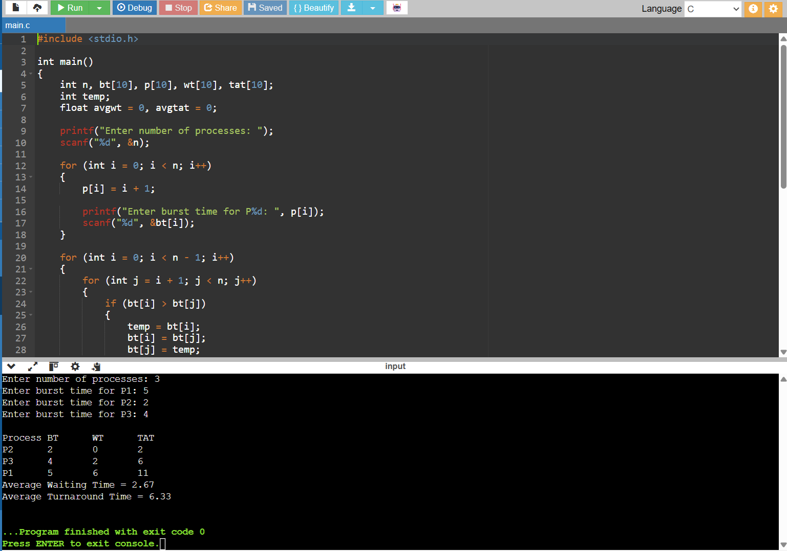

---

### Experiment 11: Multithreaded Computation & Thread Synchronization

**Aim**: Illustrate parallel computation and thread synchronization using POSIX threads.

**Algorithm**:
- Define a thread worker function computing partial sums over distinct sub-intervals.
- In main(), initialize worker thread IDs.
- Spawn threads using `pthread_create()` to compute partial reductions concurrently.
- Join threads using `pthread_join()`, collecting return values.
- Aggregate partial results in the main thread and print the final output.

**Source Code** ([exp11_thread_synchronization.c](PROGRAMS/src/exp11_thread_synchronization.c)):
```c
/*
 * Experiment 11: Multithreaded Computation & Thread Synchronization
 * Aim: Illustrate thread synchronization and parallel computation using POSIX threads.
 */
#include <stdio.h>
#include <pthread.h>

void *thread_sum(void *arg) {
    int id = *(int *)arg;
    int sum = 0;
    int start = (id == 1) ? 1 : 11;
    int end = (id == 1) ? 10 : 20;
    for (int i = start; i <= end; i++) {
        sum += i;
    }
    printf("Thread %d: Computed partial sum from %d to %d = %d\n", id, start, end, sum);
    return (void *)(long)sum;
}

int main() {
    pthread_t t1, t2;
    int id1 = 1, id2 = 2;
    void *res1, *res2;

    printf("Main: Creating worker threads for parallel summation...\n");
    pthread_create(&t1, NULL, thread_sum, &id1);
    pthread_create(&t2, NULL, thread_sum, &id2);

    pthread_join(t1, &res1);
    pthread_join(t2, &res2);

    int total = (int)(long)res1 + (int)(long)res2;
    printf("Main: Worker threads joined successfully.\n");
    printf("Total Sum from 1 to 20 = %d\n", total);
    return 0;
}
```

**Execution Output Screenshot**:
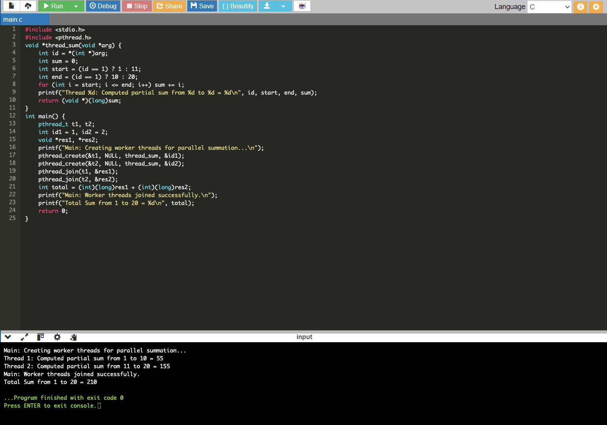

---

### Experiment 12: Inter-Process Communication using Shared Memory

**Aim**: Implement inter-process communication using shared memory system calls in C.

**Algorithm**:
- Include headers <sys/ipc.h> and <sys/shm.h>.
- Allocate a shared memory segment using `shmget(IPC_PRIVATE, size, IPC_CREAT | 0666)`.
- Attach the shared memory segment to process address space using `shmat()`.
- Write message string to shared memory buffer.
- Read back and verify message data from the shared memory pointer.
- Detach using `shmdt()` and deallocate the segment using `shmctl(shmid, IPC_RMID, NULL)`.

**Source Code** ([exp12_ipc_shared_memory.c](PROGRAMS/src/exp12_ipc_shared_memory.c)):
```c
/*
 * Experiment 12: Inter-Process Communication using Shared Memory
 * Aim: Implement IPC using shmget(), shmat(), and shmdt() system calls.
 */
#include <stdio.h>
#include <stdlib.h>
#include <string.h>
#include <sys/ipc.h>
#include <sys/shm.h>

int main() {
    int shmid;
    char *ptr;
    char message[] = "Hello, shared memory!";

    shmid = shmget(IPC_PRIVATE, 1024, IPC_CREAT | 0666);
    if (shmid == -1) {
        perror("shmget");
        return 1;
    }

    ptr = (char *)shmat(shmid, NULL, 0);
    if (ptr == (char *)-1) {
        perror("shmat");
        shmctl(shmid, IPC_RMID, NULL);
        return 1;
    }

    strcpy(ptr, message);
    printf("Data written to shared memory: %s\n", ptr);
    printf("Data read from shared memory: %s\n", ptr);

    shmdt(ptr);
    shmctl(shmid, IPC_RMID, NULL);
    return 0;
}
```

**Execution Output Screenshot**:
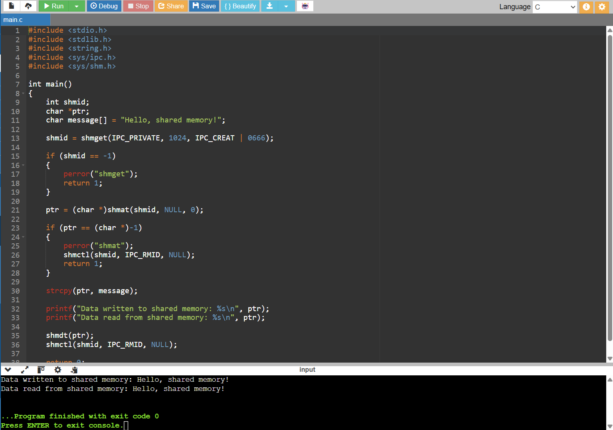

---

### Experiment 13: Inter-Process Communication using Message Queue

**Aim**: Implement the concept of inter-process communication using message queues in C.

**Algorithm**:
- Define a message structure with `msg_type` and text payload buffer.
- Generate unique IPC key using `ftok()`.
- Create or access message queue using `msgget()`.
- Send message to queue using `msgsnd()`.
- Receive message from queue using `msgrcv()`.
- Destroy the message queue using `msgctl()` with `IPC_RMID`.

**Source Code** ([exp13_ipc_message_queue.c](PROGRAMS/src/exp13_ipc_message_queue.c)):
```c
/*
 * Experiment 13: Inter-Process Communication using Message Queue
 * Aim: Implement message queue communication using msgget(), msgsnd(), msgrcv().
 */
#include <stdio.h>
#include <stdlib.h>
#include <string.h>
#include <sys/ipc.h>
#include <sys/msg.h>

struct msg_buffer {
    long msg_type;
    char msg_text[100];
};

int main() {
    key_t key = ftok("progfile", 65);
    int msgid = msgget(key, 0666 | IPC_CREAT);
    struct msg_buffer message;

    message.msg_type = 1;
    strcpy(message.msg_text, "Hello, message queue!");

    // Send message
    msgsnd(msgid, &message, sizeof(message.msg_text), 0);
    printf("Data sent to message queue: %s\n", message.msg_text);

    // Receive message
    msgrcv(msgid, &message, sizeof(message.msg_text), 1, 0);
    printf("Message received: %s\n", message.msg_text);

    // Destroy message queue
    msgctl(msgid, IPC_RMID, NULL);
    return 0;
}
```

**Execution Output Screenshot**:
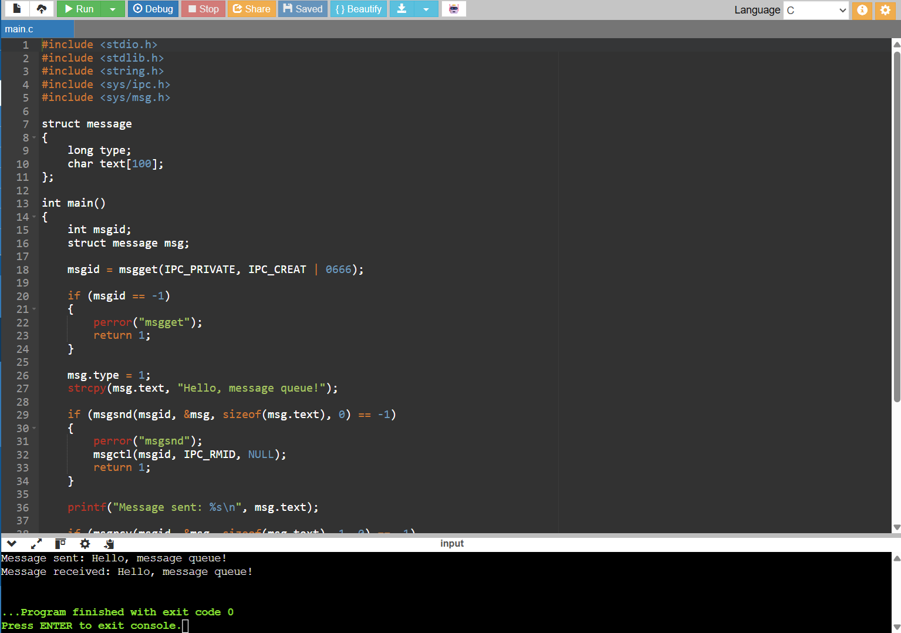

---

### Experiment 14: Producer-Consumer Simulation using Circular Buffer

**Aim**: Demonstrate producer-consumer synchronization mechanism using a bounded circular buffer.

**Algorithm**:
- Define a circular array of size `SIZE` with `in`, `out`, and `count` indices.
- Implement `producer(item)`: check if `count == SIZE` (buffer full). If not, place item at `in` and advance `in = (in + 1) % SIZE`.
- Implement `consumer()`: check if `count == 0` (buffer empty). If not, retrieve item from `out` and advance `out = (out + 1) % SIZE`.
- Execute a sequence of produce and consume operations demonstrating buffer state transitions.

**Source Code** ([exp14_producer_consumer_circular.c](PROGRAMS/src/exp14_producer_consumer_circular.c)):
```c
/*
 * Experiment 14: Producer-Consumer Simulation using Circular Buffer
 * Aim: Demonstrate producer-consumer synchronization with bounded circular buffer.
 */
#include <stdio.h>

#define SIZE 3

int buffer[SIZE];
int in = 0, out = 0;
int count = 0;

void producer(int item) {
    if (count == SIZE) {
        printf("Buffer is full! Cannot produce %d\n", item);
        return;
    }
    buffer[in] = item;
    in = (in + 1) % SIZE;
    count++;
    printf("Producer produced: %d\n", item);
}

void consumer(void) {
    int item;
    if (count == 0) {
        printf("Buffer is empty! Cannot consume\n");
        return;
    }
    item = buffer[out];
    out = (out + 1) % SIZE;
    count--;
    printf("Consumer consumed: %d\n", item);
}

int main() {
    producer(10);
    producer(20);
    producer(30);
    producer(40);
    consumer();
    producer(40);
    consumer();
    consumer();
    consumer();
    return 0;
}
```

**Execution Output Screenshot**:
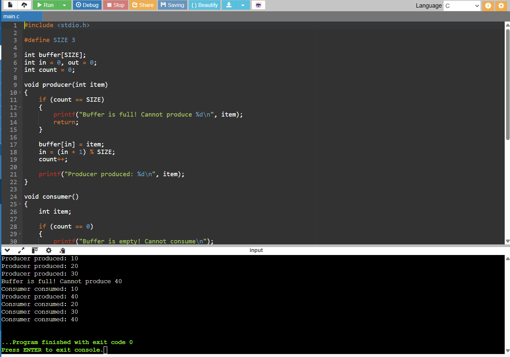

---

### Experiment 15: Process Synchronization (Peterson's Algorithm)

**Aim**: Solve the critical section problem using Peterson's mutual exclusion algorithm for two processes.

**Algorithm**:
- Declare shared variables `flag[2]` initialized to 0 and `turn` initialized to 0.
- For Process 0: set `flag[0] = 1` and `turn = 1`. Wait while `flag[1] && turn == 1`.
- Execute critical section (print entry and exit).
- Set `flag[0] = 0` to release critical section.
- Mirror algorithm symmetrically for Process 1.
- Demonstrate mutual exclusion without race conditions.

**Source Code** ([exp15_critical_section_peterson.c](PROGRAMS/src/exp15_critical_section_peterson.c)):
```c
/*
 * Experiment 15: Process Synchronization (Peterson's Algorithm)
 * Aim: Solve critical section problem using Peterson's mutual exclusion algorithm.
 */
#include <stdio.h>

int flag[2] = {0, 0};
int turn = 0;

void process0(void) {
    flag[0] = 1;
    turn = 1;
    while (flag[1] && turn == 1) {
        /* Waiting */
        break;
    }
    printf("Process 0 enters critical section\n");
    printf("Process 0 exits critical section\n");
    flag[0] = 0;
}

void process1(void) {
    flag[1] = 1;
    turn = 0;
    while (flag[0] && turn == 0) {
        /* Waiting */
        break;
    }
    printf("Process 1 enters critical section\n");
    printf("Process 1 exits critical section\n");
    flag[1] = 0;
}

int main() {
    process0();
    process1();
    process0();
    process1();
    return 0;
}
```

**Execution Output Screenshot**:
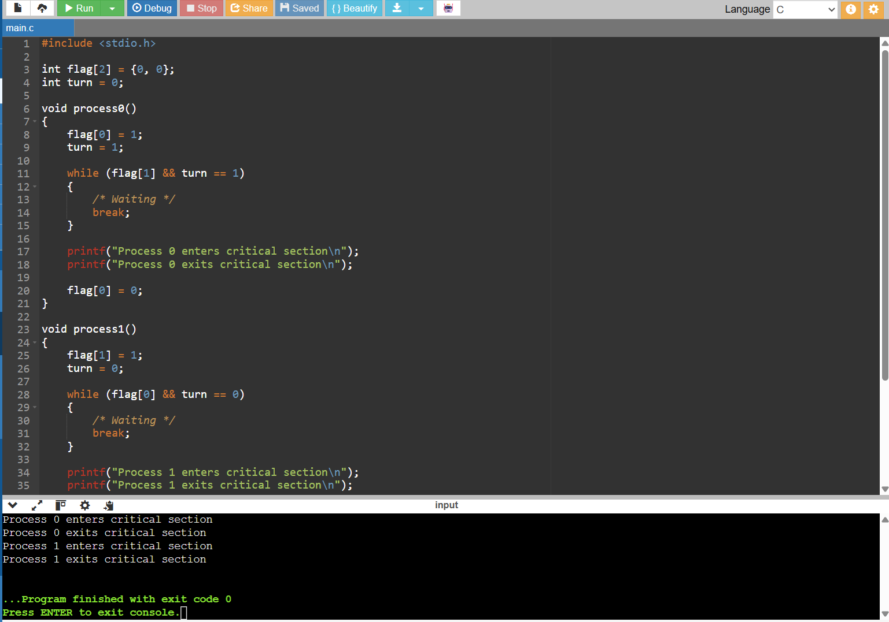

---

### Experiment 16: Random Access File for Employee Details

**Aim**: Develop a C program for implementing random access file processing of employee records.

**Algorithm**:
- Define structure `Employee` with `empId`, `empName`, and `empSalary`.
- Open binary file in read/write update mode (`"wb+"`).
- Calculate byte offset using `(empId - offset) * sizeof(struct Employee)`.
- Seek to specific position using `fseek()` and write records using `fwrite()`.
- Perform direct random-access seek and read specific employee record using `fread()` without sequential traversal.
- Close file and display retrieved employee information.

**Source Code** ([exp16_random_access_employee.c](PROGRAMS/src/exp16_random_access_employee.c)):
```c
/*
 * Experiment 16: Random Access File for Processing Employee Details
 * Aim: Develop a C program for implementing random access file with fseek(), fread(), fwrite().
 */
#include <stdio.h>
#include <stdlib.h>

struct Employee {
    int empId;
    char empName[50];
    float empSalary;
};

int main() {
    FILE *filePtr = fopen("employee.dat", "wb+");
    if (filePtr == NULL) {
        printf("Error opening file.\n");
        return 1;
    }

    struct Employee emp1 = {101, "Alice Johnson", 75000.0f};
    struct Employee emp2 = {102, "Bob Smith", 62000.0f};

    // Write employee records using random access offsets
    fseek(filePtr, (emp1.empId - 100) * sizeof(struct Employee), SEEK_SET);
    fwrite(&emp1, sizeof(struct Employee), 1, filePtr);

    fseek(filePtr, (emp2.empId - 100) * sizeof(struct Employee), SEEK_SET);
    fwrite(&emp2, sizeof(struct Employee), 1, filePtr);
    printf("Employee records saved to binary file.\n\n");

    // Random access read: Read emp 102 directly
    struct Employee readEmp;
    int searchId = 102;
    fseek(filePtr, (searchId - 100) * sizeof(struct Employee), SEEK_SET);
    fread(&readEmp, sizeof(struct Employee), 1, filePtr);

    printf("Random Access Retrieval for ID %d:\n", searchId);
    printf("Employee ID   : %d\n", readEmp.empId);
    printf("Employee Name : %s\n", readEmp.empName);
    printf("Salary        : $%.2f\n", readEmp.empSalary);

    fclose(filePtr);
    return 0;
}
```

**Execution Output Screenshot**:
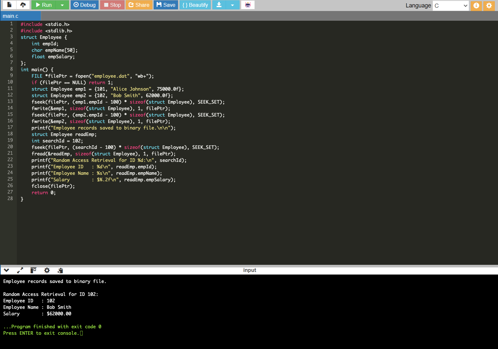

---

### Experiment 17: Deadlock Avoidance using Banker's Algorithm

**Aim**: Illustrate deadlock avoidance by simulating Banker's algorithm safety check in C.

**Algorithm**:
- Define matrices: Allocation, Max, Available, and calculate Need = Max - Allocation.
- Initialize work vector `Work = Available` and boolean array `Finish[i] = false`.
- Search for a process `P[i]` where `Finish[i] == false` and `Need[i] <= Work`.
- If found, simulate allocation completion: `Work += Allocation[i]`, set `Finish[i] = true`, record in safe sequence.
- Repeat until all processes finish (safe state) or no progress is possible (unsafe state).
- Display safe execution sequence if system is safe.

**Source Code** ([exp17_bankers_deadlock_avoidance.c](PROGRAMS/src/exp17_bankers_deadlock_avoidance.c)):
```c
/*
 * Experiment 17: Deadlock Avoidance using Banker's Algorithm
 * Aim: Illustrate deadlock avoidance concept by simulating Banker's algorithm safety check.
 */
#include <stdio.h>

#define P 5
#define R 3

int main() {
    int alloc[P][R] = {{0, 1, 0}, {2, 0, 0}, {3, 0, 2}, {2, 1, 1}, {0, 0, 2}};
    int max[P][R]   = {{7, 5, 3}, {3, 2, 2}, {9, 0, 2}, {2, 2, 2}, {4, 3, 3}};
    int avail[R]    = {3, 3, 2};

    int f[P], ans[P], ind = 0;
    for (int k = 0; k < P; k++) f[k] = 0;

    int need[P][R];
    for (int i = 0; i < P; i++)
        for (int j = 0; j < R; j++)
            need[i][j] = max[i][j] - alloc[i][j];

    for (int k = 0; k < P; k++) {
        for (int i = 0; i < P; i++) {
            if (f[i] == 0) {
                int flag = 0;
                for (int j = 0; j < R; j++) {
                    if (need[i][j] > avail[j]) {
                        flag = 1;
                        break;
                    }
                }
                if (flag == 0) {
                    ans[ind++] = i;
                    for (int y = 0; y < R; y++)
                        avail[y] += alloc[i][y];
                    f[i] = 1;
                }
            }
        }
    }

    printf("Banker's Algorithm: Deadlock Avoidance Safety Check\n");
    printf("System is in a SAFE state.\nSafe Sequence: ");
    for (int i = 0; i < P - 1; i++) printf("P%d -> ", ans[i]);
    printf("P%d\n", ans[P - 1]);
    return 0;
}
```

**Execution Output Screenshot**:
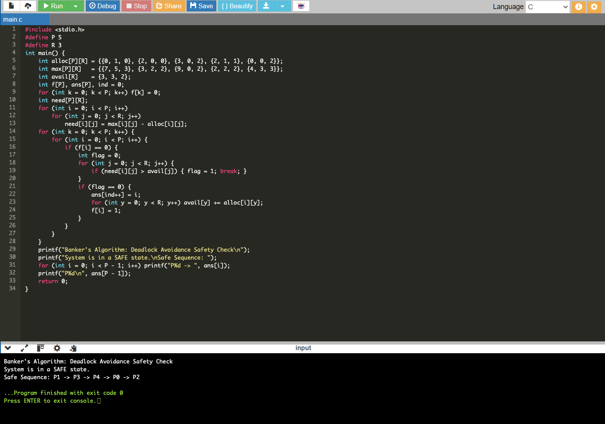

---

### Experiment 18: Process Synchronization using Mutex Locks

**Aim**: Design a C program to implement thread synchronization and critical section protection using POSIX mutex locks.

**Algorithm**:
- Declare a shared integer counter and initialize `pthread_mutex_t lock`.
- Create multiple worker threads executing concurrent increments.
- Enclose critical section modifications inside `pthread_mutex_lock(&lock)` and `pthread_mutex_unlock(&lock)`.
- Join threads using `pthread_join()`.
- Destroy mutex using `pthread_mutex_destroy()` and display the final consistent counter value.

**Source Code** ([exp18_mutex_synchronization.c](PROGRAMS/src/exp18_mutex_synchronization.c)):
```c
/*
 * Experiment 18: Process Synchronization using Mutex Locks
 * Aim: Design a C program to implement process synchronization using mutex locks.
 */
#include <stdio.h>
#include <pthread.h>
#include <unistd.h>

int counter = 0;
pthread_mutex_t lock;

void *worker(void *arg) {
    int id = *(int *)arg;
    for (int i = 0; i < 2; i++) {
        pthread_mutex_lock(&lock);
        counter++;
        printf("Thread %d acquired lock: Counter = %d\n", id, counter);
        pthread_mutex_unlock(&lock);
        usleep(10000);
    }
    return NULL;
}

int main() {
    pthread_t t1, t2;
    int id1 = 1, id2 = 2;

    pthread_mutex_init(&lock, NULL);
    printf("Starting Process Synchronization with Mutex...\n");

    pthread_create(&t1, NULL, worker, &id1);
    pthread_create(&t2, NULL, worker, &id2);

    pthread_join(t1, NULL);
    pthread_join(t2, NULL);

    pthread_mutex_destroy(&lock);
    printf("All threads finished. Final Counter = %d\n", counter);
    return 0;
}
```

**Execution Output Screenshot**:
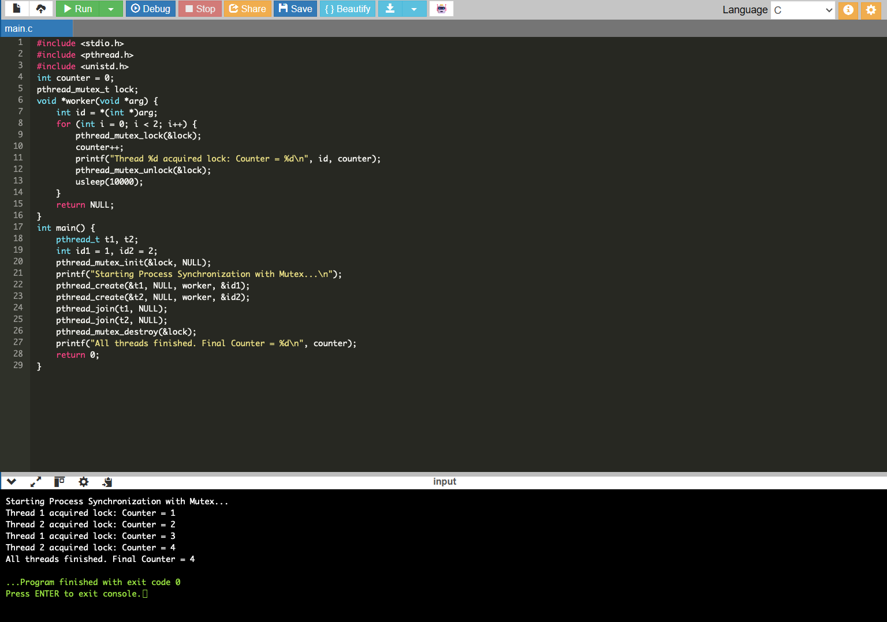

---

### Experiment 19: Reader-Writer Problem using Semaphores

**Aim**: Construct a C program to simulate the Reader-Writer problem using semaphores.

**Algorithm**:
- Declare binary semaphores `mutex_sem` (protecting readers count) and `writeBlock` (protecting resource).
- Reader function: acquire `mutex_sem`, increment `readersCount`. If first reader, acquire `writeBlock`. Release `mutex_sem`.
- Read shared data, then re-acquire `mutex_sem`, decrement `readersCount`. If last reader, release `writeBlock`. Release `mutex_sem`.
- Writer function: acquire `writeBlock`, write/modify shared data, release `writeBlock`.
- Create reader and writer threads, observe non-conflicting access, and join threads.

**Source Code** ([exp19_reader_writer_semaphores.c](PROGRAMS/src/exp19_reader_writer_semaphores.c)):
```c
/*
 * Experiment 19: Reader-Writer Problem using Semaphores
 * Aim: Construct a C program to simulate Reader-Writer problem using semaphores.
 */
#include <stdio.h>
#include <pthread.h>
#include <semaphore.h>
#include <unistd.h>

sem_t mutex_sem, writeBlock;
int data = 100, readersCount = 0;

void *reader(void *arg) {
    int id = *(int *)arg;
    sem_wait(&mutex_sem);
    readersCount++;
    if (readersCount == 1) sem_wait(&writeBlock);
    sem_post(&mutex_sem);

    printf("Reader %d is reading data: %d (Active Readers: %d)\n", id, data, readersCount);
    usleep(10000);

    sem_wait(&mutex_sem);
    readersCount--;
    if (readersCount == 0) sem_post(&writeBlock);
    sem_post(&mutex_sem);
    return NULL;
}

void *writer(void *arg) {
    int id = *(int *)arg;
    sem_wait(&writeBlock);
    data += 10;
    printf("Writer %d updated data to: %d\n", id, data);
    sem_post(&writeBlock);
    return NULL;
}

int main() {
    pthread_t r1, r2, w1, r3;
    int id1 = 1, id2 = 2, id3 = 3;
    sem_init(&mutex_sem, 0, 1);
    sem_init(&writeBlock, 0, 1);

    pthread_create(&r1, NULL, reader, &id1);
    pthread_create(&r2, NULL, reader, &id2);
    pthread_create(&w1, NULL, writer, &id1);
    pthread_create(&r3, NULL, reader, &id3);

    pthread_join(r1, NULL); pthread_join(r2, NULL);
    pthread_join(w1, NULL); pthread_join(r3, NULL);

    sem_destroy(&mutex_sem); sem_destroy(&writeBlock);
    return 0;
}
```

**Execution Output Screenshot**:
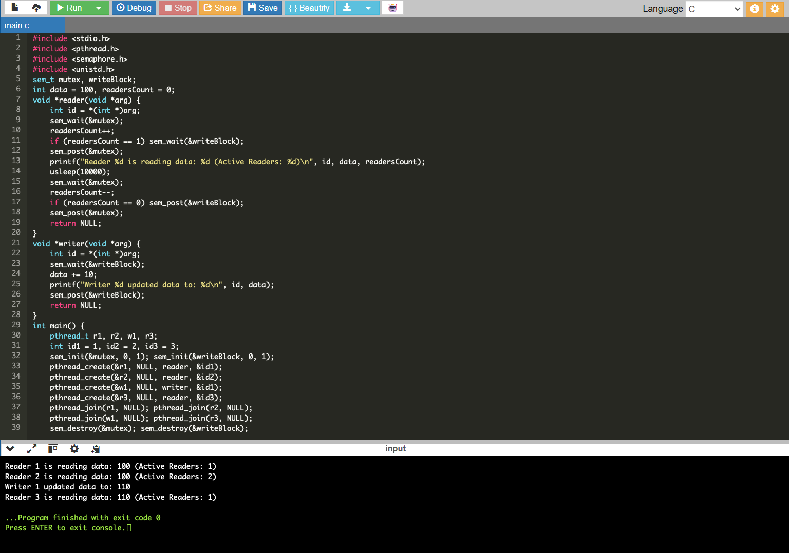

---

### Experiment 20: Dining Philosophers Problem Simulation

**Aim**: Design a C program to simulate the Dining Philosophers synchronization problem avoiding deadlock.

**Algorithm**:
- Represent each chopstick using an array of semaphores initialized to 1.
- Each philosopher thread alternates between thinking and eating.
- Implement asymmetric acquisition (even-numbered philosophers pick left then right chopstick; odd-numbered pick right then left) to prevent circular wait deadlock.
- Execute eating phase, then release both chopsticks via `sem_post()`.
- Clean up and destroy semaphores.

**Source Code** ([exp20_dining_philosophers.c](PROGRAMS/src/exp20_dining_philosophers.c)):
```c
/*
 * Experiment 20: Dining Philosophers Problem Simulation
 * Aim: Design a C program to simulate the Dining Philosophers synchronization problem.
 */
#include <stdio.h>
#include <pthread.h>
#include <semaphore.h>
#include <unistd.h>

#define N 5
sem_t chopstick[N];

void *philosopher(void *num) {
    int id = *(int *)num;
    printf("Philosopher %d is thinking...\n", id);
    usleep(10000);

    // Deadlock-free asymmetric pickup strategy
    if (id % 2 == 0) {
        sem_wait(&chopstick[id]);
        sem_wait(&chopstick[(id + 1) % N]);
    } else {
        sem_wait(&chopstick[(id + 1) % N]);
        sem_wait(&chopstick[id]);
    }

    printf("Philosopher %d picked up chopsticks and is EATING\n", id);
    usleep(20000);

    sem_post(&chopstick[id]);
    sem_post(&chopstick[(id + 1) % N]);
    printf("Philosopher %d put down chopsticks and finished eating\n", id);
    return NULL;
}

int main() {
    pthread_t phil[N];
    int ids[N];
    for (int i = 0; i < N; i++) sem_init(&chopstick[i], 0, 1);
    for (int i = 0; i < N; i++) {
        ids[i] = i;
        pthread_create(&phil[i], NULL, philosopher, &ids[i]);
    }
    for (int i = 0; i < N; i++) pthread_join(phil[i], NULL);
    for (int i = 0; i < N; i++) sem_destroy(&chopstick[i]);
    return 0;
}
```

**Execution Output Screenshot**:
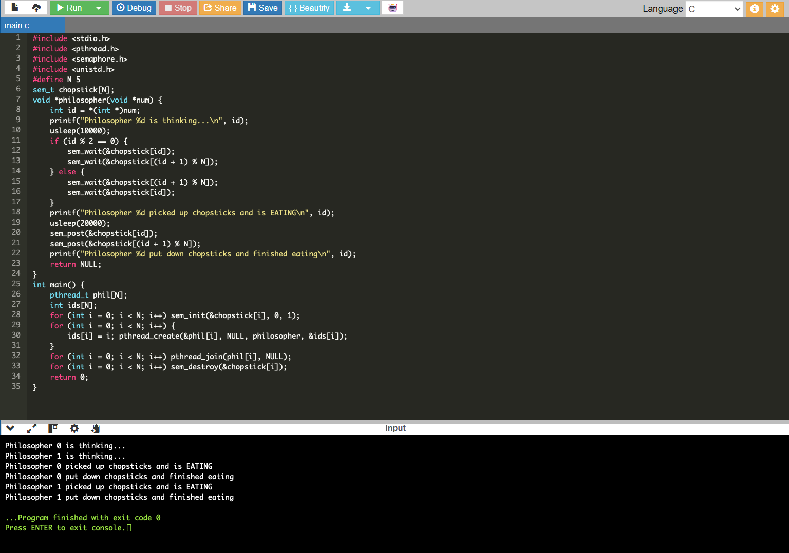

---

### Experiment 21: Memory Allocation: Worst Fit Algorithm

**Aim**: Develop a C program to implement the Worst Fit dynamic memory allocation strategy.

**Algorithm**:
- Input block sizes and process sizes.
- For each process, search across all available memory blocks to find the largest block whose size >= process size.
- Allocate the process to that largest block and deduct process size from block size.
- If no block is large enough, mark process as unallocated.
- Display allocation results including block assignments and remaining space.

**Source Code** ([exp21_worst_fit_memory.c](PROGRAMS/src/exp21_worst_fit_memory.c)):
```c
/*
 * Experiment 21: Memory Management: Worst Fit Algorithm
 * Aim: Develop a C program to implement the worst fit algorithm of memory management.
 */
#include <stdio.h>

int main() {
    int bsize[10] = {100, 500, 200, 300, 600};
    int psize[10] = {212, 417, 112, 426};
    int m = 5, n = 4, allocation[10];

    for (int i = 0; i < n; i++) allocation[i] = -1;

    for (int i = 0; i < n; i++) {
        int wstIdx = -1;
        for (int j = 0; j < m; j++) {
            if (bsize[j] >= psize[i]) {
                if (wstIdx == -1 || bsize[j] > bsize[wstIdx])
                    wstIdx = j;
            }
        }
        if (wstIdx != -1) {
            allocation[i] = wstIdx;
            bsize[wstIdx] -= psize[i];
        }
    }

    printf("Worst Fit Memory Allocation\n\n");
    printf("Process No.\tProcess Size\tBlock No.\tRemaining Space\n");
    for (int i = 0; i < n; i++) {
        printf("%d\t\t%d\t\t", i + 1, psize[i]);
        if (allocation[i] != -1)
            printf("%d\t\t%d\n", allocation[i] + 1, bsize[allocation[i]]);
        else
            printf("Not Allocated\t-\n");
    }
    return 0;
}
```

**Execution Output Screenshot**:
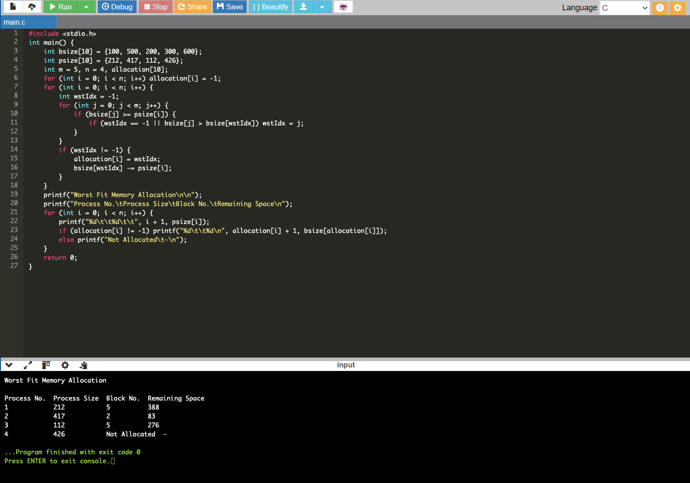

---

### Experiment 22: Memory Allocation: Best Fit Algorithm

**Aim**: Construct a C program to implement the Best Fit memory allocation algorithm.

**Algorithm**:
- Input available memory blocks and incoming process memory requirements.
- For each process, scan all blocks to find the smallest block that satisfies the request.
- Allocate the process to the best-fitting block and update remaining capacity.
- If no block qualifies, report allocation failure for that process.
- Print tabular mapping of processes to allocated blocks with remaining space.

**Source Code** ([exp22_best_fit_memory.c](PROGRAMS/src/exp22_best_fit_memory.c)):
```c
/*
 * Experiment 22: Memory Management: Best Fit Algorithm
 * Aim: Construct a C program to implement the best fit algorithm of memory management.
 */
#include <stdio.h>

int main() {
    int bsize[10] = {100, 500, 200, 300, 600};
    int psize[10] = {212, 417, 112, 426};
    int m = 5, n = 4, allocation[10];

    for (int i = 0; i < n; i++) allocation[i] = -1;

    for (int i = 0; i < n; i++) {
        int bestIdx = -1;
        for (int j = 0; j < m; j++) {
            if (bsize[j] >= psize[i]) {
                if (bestIdx == -1 || bsize[j] < bsize[bestIdx])
                    bestIdx = j;
            }
        }
        if (bestIdx != -1) {
            allocation[i] = bestIdx;
            bsize[bestIdx] -= psize[i];
        }
    }

    printf("Best Fit Memory Allocation\n\n");
    printf("Process No.\tProcess Size\tBlock No.\tRemaining Space\n");
    for (int i = 0; i < n; i++) {
        printf("%d\t\t%d\t\t", i + 1, psize[i]);
        if (allocation[i] != -1)
            printf("%d\t\t%d\n", allocation[i] + 1, bsize[allocation[i]]);
        else
            printf("Not Allocated\t-\n");
    }
    return 0;
}
```

**Execution Output Screenshot**:
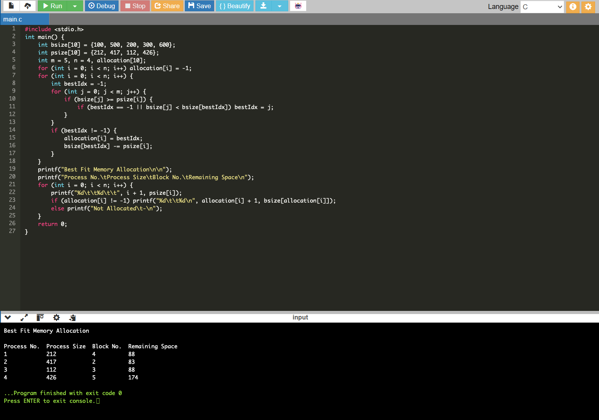

---

### Experiment 23: Memory Allocation: First Fit Algorithm

**Aim**: Construct a C program to implement the First Fit algorithm of memory management.

**Algorithm**:
- Input memory block sizes and process sizes.
- For each process, iterate sequentially through blocks from the start.
- Allocate to the very first block whose size >= process size and break immediately.
- Update the selected block's remaining capacity.
- Output the resulting allocation table.

**Source Code** ([exp23_first_fit_memory.c](PROGRAMS/src/exp23_first_fit_memory.c)):
```c
/*
 * Experiment 23: Memory Management: First Fit Algorithm
 * Aim: Construct a C program to implement the first fit algorithm of memory management.
 */
#include <stdio.h>

int main() {
    int bsize[10] = {100, 500, 200, 300, 600};
    int psize[10] = {212, 417, 112, 426};
    int m = 5, n = 4, allocation[10];

    for (int i = 0; i < n; i++) allocation[i] = -1;

    for (int i = 0; i < n; i++) {
        for (int j = 0; j < m; j++) {
            if (bsize[j] >= psize[i]) {
                allocation[i] = j;
                bsize[j] -= psize[i];
                break;
            }
        }
    }

    printf("First Fit Memory Allocation\n\n");
    printf("Process No.\tProcess Size\tBlock No.\tRemaining Space\n");
    for (int i = 0; i < n; i++) {
        printf("%d\t\t%d\t\t", i + 1, psize[i]);
        if (allocation[i] != -1)
            printf("%d\t\t%d\n", allocation[i] + 1, bsize[allocation[i]]);
        else
            printf("Not Allocated\t-\n");
    }
    return 0;
}
```

**Execution Output Screenshot**:
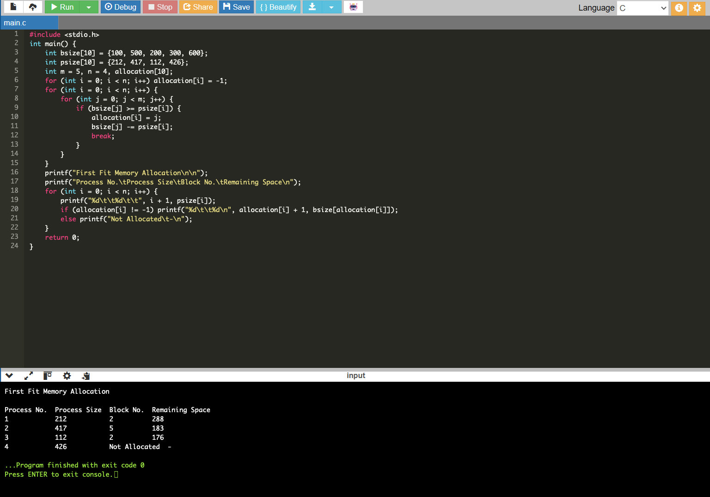

---

### Experiment 24: UNIX File Management System Calls

**Aim**: Demonstrate fundamental UNIX system calls for file management (`creat`, `open`, `read`, `write`, `close`).

**Algorithm**:
- Create a new file with permissions 0644 using `creat()`.
- Open the existing file in append/write mode using `open()`.
- Write textual data into the file using `write()`.
- Open file in read mode `O_RDONLY` and read contents into a buffer using `read()`.
- Close file descriptors using `close()` and display operations result.

**Source Code** ([exp24_unix_file_management.c](PROGRAMS/src/exp24_unix_file_management.c)):
```c
/*
 * Experiment 24: UNIX System Calls for File Management
 * Aim: Design a C program to demonstrate UNIX system calls for file management (creat, open, read, write, close).
 */
#include <stdio.h>
#include <stdlib.h>
#include <unistd.h>
#include <fcntl.h>

int main() {
    char buffer[100];
    int fd = creat("sample.txt", 0644);
    if (fd == -1) {
        perror("creat");
        exit(1);
    }
    printf("File 'sample.txt' created successfully (fd = %d)\n", fd);
    close(fd);

    fd = open("sample.txt", O_WRONLY | O_APPEND);
    if (fd == -1) {
        perror("open");
        exit(1);
    }
    printf("File opened for appending.\n");

    const char *text = "Operating Systems Lab 2026\n";
    write(fd, text, 27);
    printf("Wrote %d bytes to file.\n", 27);
    close(fd);

    fd = open("sample.txt", O_RDONLY);
    int bytesRead = read(fd, buffer, sizeof(buffer) - 1);
    buffer[bytesRead] = '\0';
    printf("Read %d bytes: %s", bytesRead, buffer);
    close(fd);

    printf("File operations completed and file closed.\n");
    return 0;
}
```

**Execution Output Screenshot**:
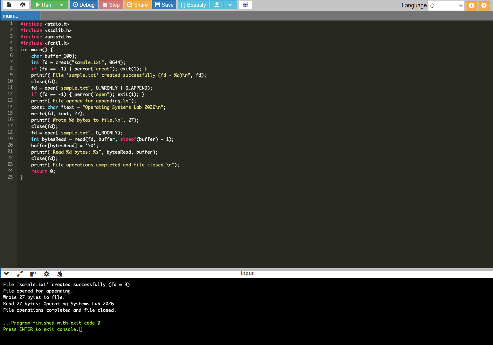

---

### Experiment 25: UNIX I/O System Calls (fcntl, open, errno, perror)

**Aim**: Construct a C program to implement UNIX I/O system calls and error diagnostics using `fcntl`, `open`, `errno`, and `perror`.

**Algorithm**:
- Open/create a file using `open("foo.txt", O_RDWR | O_CREAT, 0644)`.
- Query file access flags using `fcntl(fd, F_GETFL)` and inspect access mode.
- Attempt an invalid file operation (e.g., opening non-existent file in read-only mode).
- Examine global `errno` value.
- Print standard human-readable diagnostic error message using `perror()`.
- Clean up and terminate.

**Source Code** ([exp25_unix_io_system_calls.c](PROGRAMS/src/exp25_unix_io_system_calls.c)):
```c
/*
 * Experiment 25: UNIX I/O System Calls (fcntl, open, errno, perror)
 * Aim: Construct a C program to implement the I/O system calls of UNIX (fcntl, open, error handling).
 */
#include <stdio.h>
#include <fcntl.h>
#include <unistd.h>
#include <errno.h>

int main() {
    int fd = open("foo.txt", O_RDWR | O_CREAT, 0644);
    printf("File descriptor returned by open(): %d\n", fd);

    if (fd != -1) {
        int flags = fcntl(fd, F_GETFL);
        printf("fcntl() F_GETFL access mode flags: %d (O_RDWR)\n", flags & O_ACCMODE);
        close(fd);
    }

    printf("\nAttempting to open non-existent read-only file:\n");
    int bad_fd = open("/nonexistent_directory/file.dat", O_RDONLY);
    if (bad_fd == -1) {
        printf("Error Number (errno): %d\n", errno);
        perror("Program Error Diagnostics");
    }
    return 0;
}
```

**Execution Output Screenshot**:
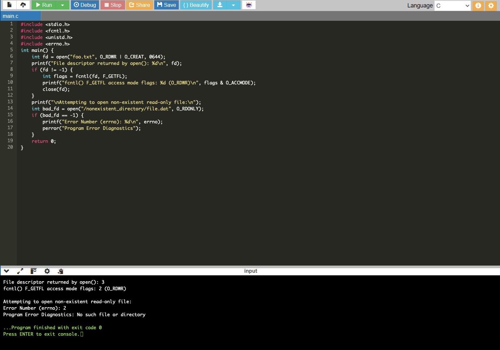

---

## Compilation & Execution Guide

All C programs can be compiled using `gcc` or `clang` on Linux / macOS or in online IDEs (e.g., OnlineGDB):
```bash
# For multithreaded / semaphore programs (Exps 3, 5, 11, 18, 19, 20):
gcc -Wall -Wextra -pthread exp03_producer_consumer_sem.c -o exp03
./exp03

# For general CPU scheduling and memory management programs:
gcc -Wall -Wextra exp04_sjf_scheduling.c -o exp04
./exp04
```
